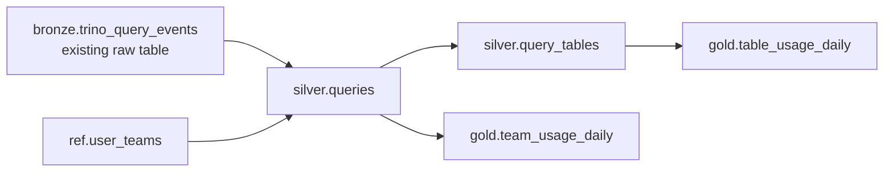
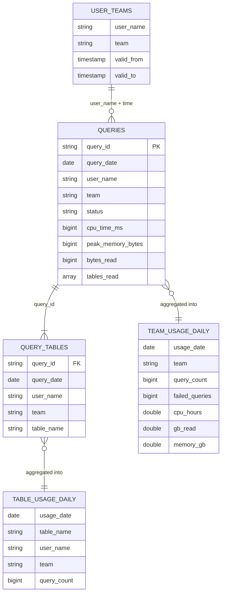

# trino-usage-dwh

## 1. Overview

Trino query events are already collected into an Apache Iceberg table on Amazon S3.
We want to know how tables are used (e.g. how many distinct users queried table X
during a period) and how many resources each team consumed, with full history.
This repository proposes a small Meta DWH on Iceberg using **Bronze → Silver → Gold**
layers and fills it with a daily **Spark SQL** batch job run by a small Python runner.

## 2. Architecture



Bronze is the existing raw Iceberg table written by Trino's event listener. We read
it directly and do not copy it. `00_bronze_trino_query_events.sql` exists only to
create it for the local demo.

## 3. Data model

| Layer | Table | Granularity | Columns |
|---|---|---|---|
| Bronze | `bronze.trino_query_events` | one raw event | query_id, user_name, query_state, start_time, end_time, cpu_time_ms, peak_memory_bytes, bytes_read, tables_read, ingested_at |
| Ref | `ref.user_teams` | user × validity period | user_name, team, valid_from, valid_to |
| Silver | `silver.queries` | one query | query_id, query_date, user_name, team, status, cpu_time_ms, peak_memory_bytes, bytes_read, tables_read |
| Silver | `silver.query_tables` | query × table | query_id, query_date, user_name, team, table_name |
| Gold | `gold.table_usage_daily` | day × table × user | usage_date, table_name, user_name, team, query_count |
| Gold | `gold.team_usage_daily` | day × team | usage_date, team, query_count, failed_queries, cpu_hours, gb_read, memory_gb |

Relationships: `silver.queries` 1 → N `silver.query_tables` (by `query_id`); users
map to teams via `ref.user_teams`; Gold is built from Silver. Silver and Gold tables
are partitioned by date.

Inside the layers this is a simple dimensional model: facts are queries and table
accesses, the dimension is user-to-team, and Gold holds daily aggregates.



## 4. Transformations

Every step processes data from `${start_date}` on (default: today − 3 days). The
runner executes the files in this order:

- `10_silver_queries.sql` — deduplicates Bronze events by `query_id` (latest
  `ingested_at` wins), attaches the team valid at query start time (`UNKNOWN` if
  none) and `MERGE`s into `silver.queries`: new queries are inserted, re-sent ones
  are updated.
- `20_silver_query_tables.sql` — explodes `tables_read` into one row per query ×
  table (`DISTINCT`, so a self-join counts once) and overwrites the affected days.
- `30_gold_table_usage_daily.sql` — counts queries per day × table × user.
- `40_gold_team_usage_daily.sql` — sums queries, failures, CPU hours, GB read and
  memory per day × team, directly from `silver.queries`.

`INSERT OVERWRITE` runs with `spark.sql.sources.partitionOverwriteMode=dynamic`,
so only the reprocessed date partitions are replaced; older history stays as is.

## 5. Example queries

| File | Question it answers | Demo result |
|---|---|---|
| `sql/queries/distinct_users_per_table.sql` | How many distinct users queried `iceberg.sales.orders` from 2026-10-01 to 2026-10-24? | 15 users |
| `sql/queries/team_resource_usage.sql` | How many resources did team `analytics` consume in the same period? | 493 queries, 23 failed, 228.3 CPU hours, 11,985 GB read, 1,951 GB memory |
| `sql/queries/weekly_table_trend.sql` | How does usage of `iceberg.sales.orders` change week by week? | 5 weeks, 75–204 queries per week |

The dates in the queries match the demo data (2026-09-25 … 2026-10-24). The first
and last weeks of the trend are partial.

## 6. Design choices

- **Resource metrics**: CPU time (main compute cost), bytes read (S3 scan cost),
  peak memory (how heavy queries are), failed queries (wasted resources).
  `memory_gb` is the sum of per-query peaks: it compares how memory-heavy teams
  are, it is not the memory held at one moment.
- Resources are stored once per query in `silver.queries`, so team totals are
  never double counted when a query reads several tables.
- The user is kept in `gold.table_usage_daily` because distinct users cannot be
  summed across days; this keeps distinct counts exact for any period.
- **Updates**: a daily Spark job (usage stats don't need real time) reprocesses the
  last 3 days to handle late and duplicate events (`MERGE` on `query_id`, dynamic
  partition overwrite). Jobs are idempotent: a backfill is a rerun with an older
  `--start-date`. Gold keeps full history for trends. Events more than 3 days late,
  or a corrected team mapping for older days, need such a backfill.
- Spark was chosen because I have experience with it; the same SQL could run
  directly in Trino with dbt or Airflow, without a separate Spark cluster.
- **Monitoring**: track events processed, step duration, and the share of
  `UNKNOWN` team usage. The runner logs row counts and duration per step.

## 7. Assumptions

- Bronze schema as described above: one event per completed query; duplicates and
  late events are possible.
- **Users → teams**: Trino has no team concept, so `ref.user_teams` is loaded daily
  from HR/LDAP with validity dates. Queries are attributed to the team the user
  belonged to when the query ran. Service accounts are mapped to their owning team
  in the same table. Unmapped users → `UNKNOWN`.
- **Queries touching multiple tables**: one row per table in `silver.query_tables`;
  a table read twice in one query (self-join) counts once.
- A query belongs to the day it finished (`end_time`); days are UTC days.
- Only read access is tracked; writes could be added the same way.

## 8. Additional metadata needed

- User-to-team mapping (HR/LDAP).
- Table ownership, to answer "who uses my tables".
- Full table inventory from the Iceberg catalog, to find tables that are never queried.
- Optional cost rates, to convert CPU hours / GB read into money.

## 9. How to run locally

### Setup

- Python 3.8+ (tested with 3.12) and Java 11 or 17 (tested with 17), with `JAVA_HOME` set.
- **Windows only**: Spark also needs `winutils.exe` and `hadoop.dll` (a Hadoop 3.3
  build, e.g. from [cdarlint/winutils](https://github.com/cdarlint/winutils)).
  Put them into `C:\hadoop\bin`, set `HADOOP_HOME=C:\hadoop` and add
  `C:\hadoop\bin` to `PATH`. Open a new terminal after changing these variables.
- Internet access on the first run: Spark downloads the Iceberg runtime jar from
  Maven Central.

```bash
pip install -r requirements.txt
```

### Run the demo

```bash
python pipeline/run_pipeline.py --demo --run-queries
```

This fills Bronze and Ref with sample data (2000 queries over 30 days, 15 users,
4 teams), runs all steps for the whole sample period and prints the three example
queries. It takes about a minute. The `:: loading settings` / `Ivy` lines at the
start are Spark resolving the Iceberg jar, not errors. Then one log line per step:

```
INFO generate_sample_data                     rows=2040   4.2s
INFO 10_silver_queries.sql                    rows=2000   4.2s
INFO 20_silver_query_tables.sql               rows=3614   2.2s
INFO 30_gold_table_usage_daily.sql            rows=2322   1.8s
INFO 40_gold_team_usage_daily.sql             rows=149    1.3s
```

Bronze has 2040 events for 2000 queries: the 40 duplicates are removed in Silver.
Running the same command again gives the same row counts (idempotency). Iceberg
tables are stored in `./warehouse`; delete that folder to start from scratch.

### Other runs

```bash
python pipeline/run_pipeline.py                            # daily run: last 3 days
python pipeline/run_pipeline.py --start-date 2026-10-01    # backfill from a date
```
